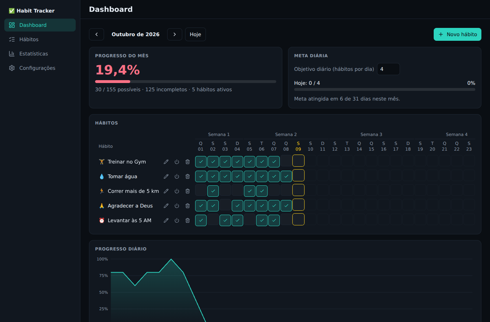
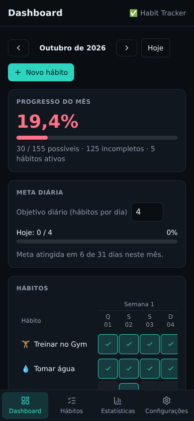

# Habit Tracker

Aplicação web de acompanhamento de hábitos com visual de dashboard: marque hábitos por dia, navegue entre meses e acompanhe o progresso diário, semanal, mensal e por hábito. Os dados ficam no próprio navegador (`localStorage`); não há backend nem conta de usuário.





> As imagens usam dados de exemplo gerados para a captura.

## Funcionalidades

- **Hábitos:** criar, editar, ativar/desativar e excluir (com confirmação). Cada hábito tem nome, ícone (emoji) e meta mensal em dias.
- **Calendário mensal:** tabela de hábitos × dias gerada com `date-fns` (28, 29, 30 e 31 dias, anos bissextos e virada de ano), com navegação entre meses.
- **Marcação diária:** clique (ou Espaço/Enter) para marcar e desmarcar; a interface atualiza na hora.
- **Progresso:** diário, semanal, mensal e por hábito, sempre calculado a partir dos dados.
- **Metas:** meta mensal por hábito e objetivo diário (quantos hábitos concluir por dia).
- **Gráfico** de progresso diário e página de **Estatísticas** (melhores dias, totais, semanas e hábitos).
- **Persistência automática**, com proteção contra dados inválidos, aviso e cópia de segurança.
- **Responsivo e acessível:** sidebar no desktop e barra inferior no celular, navegação por teclado, modais com foco preso e verificada manualmente com axe-core.

## Tecnologias

React 19 · Vite 8 · TypeScript 7 (strict) · Tailwind CSS 4 · Recharts · date-fns · Lucide React.
Qualidade: Vitest + jsdom (testes) e Biome (lint).

## Requisitos

- Node.js **22.12 ou superior** (o app e o build funcionam a partir do 20.19; os testes exigem 22.12+).
- npm.

## Instalação e execução

```bash
npm install
npm run dev
```

Abra o endereço exibido no terminal (por padrão, `http://localhost:5173`).

## Comandos

| Comando | O que faz |
| --- | --- |
| `npm run dev` | Servidor de desenvolvimento |
| `npm run build` | Checagem de tipos (`tsc --noEmit`) e build de produção em `dist/` |
| `npm run preview` | Serve o build de produção localmente |
| `npm run lint` | Lint com Biome |
| `npm test` | Testes automatizados (Vitest) |

O build gera arquivos estáticos em `dist/`. Não há deploy configurado neste repositório.

## Estrutura do projeto

```text
src/
├── components/
│   ├── dashboard/   # tabela de hábitos, células, gráfico, resumos, meta diária
│   ├── habits/      # formulário e lista de hábitos
│   ├── layout/      # Sidebar, Topbar, avisos e ErrorBoundary
│   └── ui/          # Button, Card, Modal, Select, Tooltip, ProgressBar
├── pages/           # Dashboard, Habits, Statistics, Settings
├── context/         # HabitContext (provider) e habitReducer
├── hooks/           # useHabits, useMonthData, useHabitDialogs
├── services/        # persistence (interface) e storage (localStorage)
├── utils/           # cálculos, calendário, formatação (funções puras)
├── types/           # tipos do domínio e da navegação
└── data/            # hábitos de exemplo do primeiro acesso
docs/                # especificação do produto e imagens
```

## Arquitetura

- **Estado:** `useReducer` + Context. O reducer é a única fonte de verdade; tabela, gráfico e resumos derivam dos mesmos dados.
- **Cálculos:** funções puras em `src/utils`, sem React e sem persistência. Percentuais nunca são armazenados.
- **Persistência:** o restante da aplicação só usa a interface `persistence` (`src/services/persistence.ts`); `localStorage` é a implementação atual. Trocar por uma API significa criar outro adapter, e uma API assíncrona exigiria um estado de carregamento no `HabitProvider` (detalhes no próprio arquivo). `src/architecture.test.ts` falha se essa separação for quebrada.
- **Navegação:** estado simples em `App.tsx`, sem biblioteca de rotas.

## Modelo de dados

Definido em `src/types/habit.ts` e salvo na chave `habit-tracker-data`:

```ts
interface Habit {
  id: string
  name: string
  icon?: string
  color?: string     // previsto no modelo; ainda não usado na interface
  active: boolean
  createdAt: string  // ISO
  goal?: number      // meta mensal, em dias
}

interface HabitCompletion {
  habitId: string
  date: string       // YYYY-MM-DD
  completed: boolean
}

interface AppSettings {
  dailyGoal?: number // hábitos a concluir por dia
}
```

Ao carregar, os dados são normalizados: campos ausentes recebem padrões, ids de hábito repetidos mantêm o primeiro e conclusões órfãs, repetidas ou de datas inexistentes são descartadas. Conteúdo ilegível não derruba o app: ele abre com os hábitos de exemplo, mostra um aviso e guarda uma cópia do original (com opção de baixá-la).

## Decisões importantes

- **Desativar × excluir:** desativar mantém todo o histórico e tira o hábito dos cálculos; excluir remove o hábito e o histórico dele (o modal avisa).
- **Semanas** começam na segunda-feira; a primeira e a última semana do mês podem ter menos de 7 dias.
- **Progresso mensal** = conclusões ÷ (hábitos ativos × dias do mês). O denominador inclui dias que ainda não aconteceram; por isso, no meio do mês o percentual parece baixo. Contar só até hoje seria uma mudança de regra de negócio, ainda não feita.
- **Dias futuros** podem ser marcados, mas ficam visualmente discretos e não entram no gráfico.
- **Lint com Biome:** o `typescript-eslint` ainda não suporta o TypeScript 7 usado no projeto.
- **Células de dia** são botões com `role="checkbox"` e `aria-checked`, com `aria-label` completo (hábito, data e estado).

## Limitações conhecidas

- Os dados existem só no navegador onde foram criados: sem sincronização, backup automático ou conta.
- A responsividade e o teclado foram verificados em Chromium; Safari/iOS e leitores de tela reais não foram testados.
- Fora do escopo do MVP: backend, login, notificações, gamificação, IA e aplicativos nativos.

## Como contribuir

O fluxo de trabalho está em [`CLAUDE.md`](CLAUDE.md) e o roteiro em [`TASKS.md`](TASKS.md); a especificação do produto está em [`docs/ESPECIFICACAO.md`](docs/ESPECIFICACAO.md).

1. Trabalhe em uma tarefa por vez e mantenha a mudança restrita a ela.
2. Antes de abrir uma contribuição, rode `npm run build`, `npm run lint` e `npm test`.
3. Mensagens de commit no formato `tipo: descrição` (por exemplo, `feat:`, `fix:`, `refactor:`, `test:`).
4. Nova dependência só com justificativa (nome, motivo, alternativa sem dependência e impacto).

## Licença

Ainda não definida. Adicione um arquivo `LICENSE` antes de publicar o projeto ou aceitar contribuições externas.
